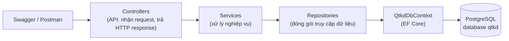
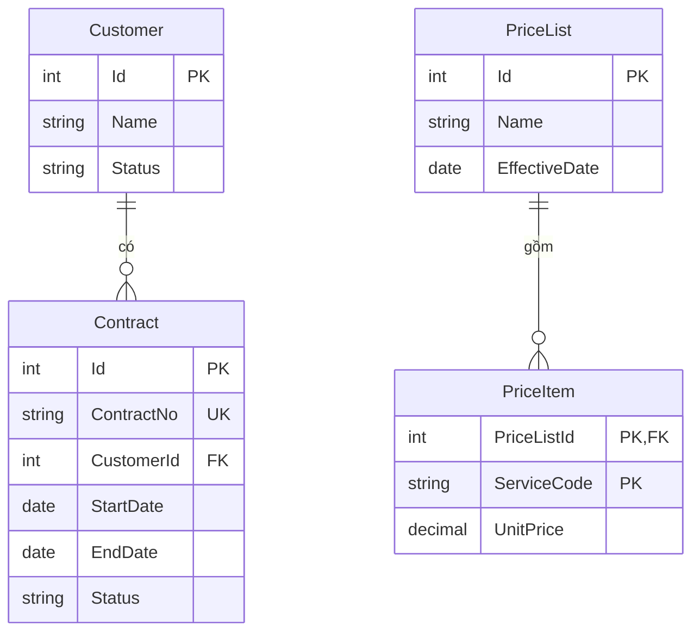

# Kiến trúc và mô hình dữ liệu – Tuần 05

## Các thành phần chính

| Thành phần | Thư mục | Trách nhiệm |
|---|---|---|
| API | `src/QTKD.Api/Controllers` | Nhận HTTP request, gọi Service, trả status code |
| Nghiệp vụ | `src/QTKD.Api/Services` | Logic nghiệp vụ (tuần 06 thêm CTR-01..03, submit) |
| Truy cập dữ liệu | `src/QTKD.Api/Repositories`, `Data` | Truy vấn EF Core, `QtkdDbContext`, dữ liệu mẫu |
| Mô hình | `src/QTKD.Api/Entities`, `DTOs` | Entity lưu DB; DTO trả cho client |

## Mô hình dữ liệu

## Giả định cần đối chiếu với Phase 1

- Các trường lấy theo gợi ý tối thiểu của đề thực hành; nếu đặc tả Phase 1 đã xác nhận khác thì cập nhật entity và ghi lý do ở đây.
- `ContractStatus` gồm Draft, RevisionRequested, PendingApproval, Approved (theo sơ đồ trạng thái trong đề). Cần đối chiếu với sơ đồ Phase 1.
- `PriceItem` dùng khóa chính kép (PriceListId, ServiceCode) vì đề không nêu Id riêng.
- `ContractNo` là duy nhất (unique index).
- Trạng thái lưu dạng chuỗi trong database để dễ đọc khi kiểm tra bằng SQL.
